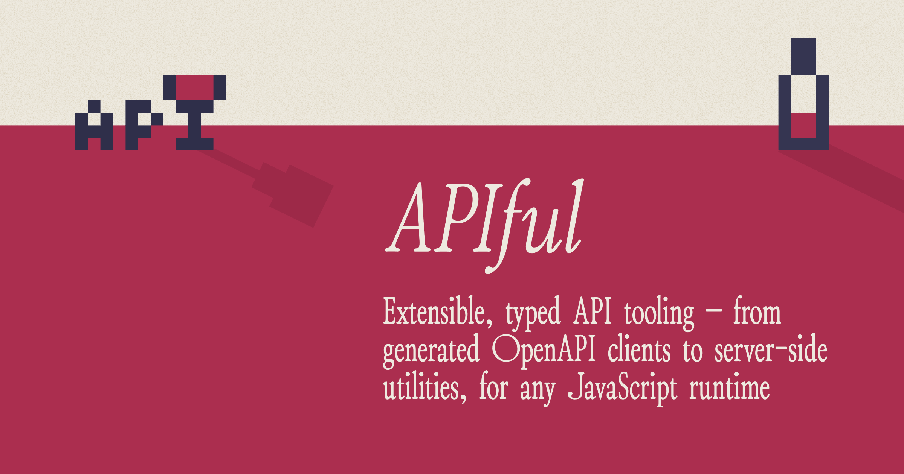

[](https://apiful.land)

# APIful

An APIful client is a set of default fetch options – a base URL, headers, retries – plus the extensions you add to it. The extensions decide how you write a request and how much of it TypeScript knows: plain `fetch`-style calls, a chain of path segments, or paths and responses typed from an OpenAPI schema.

Start with one of the [built-in extensions](https://apiful.land/extensions/), or [write your own](https://apiful.land/guide/custom-extensions).

## Setup

> [!TIP]
> [📖 Read the documentation](https://apiful.land)

> [!NOTE]
> Upgrading from v5? See the [migration guide](https://apiful.land/guide/migration). Coming from openapi-typescript and openapi-fetch? See [Migrating From openapi-typescript and openapi-fetch](https://apiful.land/guide/migrating-from-openapi-typescript).

```bash
# pnpm
pnpm add apiful

# npm
npm i apiful
```

## Usage

### Your First API Client

Create your first API client by initializing it with a base URL and a sample bearer token for authorization:

```ts
import { createClient } from 'apiful'

const client = createClient({
  baseURL: 'https://api.example.com',
  headers: {
    Authorization: `Bearer ${process.env.API_KEY}`,
  },
})
```

> [!NOTE]
> The `createClient` function returns an [`ApiClient`](https://apiful.land/reference/api-client) instance that can't yet make requests. You'll need to add a handler extension to enable HTTP functionality. Read on to learn how to do this.

### Built-in Extensions

<table><tr><td width="500px" valign="top">

### `ofetchBuilder`

```ts
import { createClient, ofetchBuilder } from 'apiful'

const api = createClient({ baseURL: 'https://api.example.com' })
  .with(ofetchBuilder())

// GET request to https://api.example.com/users/1
await api('users/1', { method: 'GET' })
```

</td><td width="500px"><br>

**What it does:**

The `ofetchBuilder` wraps [ofetch](https://github.com/unjs/ofetch) to handle API requests.

</td></tr><tr><td width="500px" valign="top">

### `apiRouterBuilder`

```ts
import { apiRouterBuilder, createClient } from 'apiful'

const api = createClient({ baseURL: 'https://api.example.com' })
  .with(apiRouterBuilder())

// GET request to https://api.example.com/users/1
await api.users(1).get()
// POST request to https://api.example.com/users with payload
await api.users.post({ name: 'foo' })
```

</td><td width="500px"><br>

**What it does:**

The `apiRouterBuilder` provides a jQuery-like and Axios-style API for building and making API requests. It allows you to construct your API calls in a declarative way.

</td></tr><tr><td width="500px" valign="top">

### `openAPIBuilder`

```ts
import { createClient, openAPIBuilder } from 'apiful'

const api = createClient({ baseURL: 'https://petstore3.swagger.io/api/v3' })
  // Pass the service name from apiful.config.ts
  .with(openAPIBuilder<'petStore'>())

// Typed parameters and response
const response = await api('/user/{username}', {
  method: 'GET',
  path: { username: 'user1' },
})
```

</td><td width="500px"><br>

**What it does:**

If your API has an [OpenAPI](https://swagger.io/resources/open-api/) schema, APIful can use it to generate types for you, which the `openAPIBuilder` extension then consumes to provide type-safe API calls.

For example, the response returned by the API call on the left is typed as follows:

```ts
const response: {
  id?: number
  username?: string
  // …
}
```

Follow the [OpenAPI extension documentation](https://apiful.land/extensions/openapi) to learn more about how to generate types from your OpenAPI schema files.

</td></tr></table>

### Custom Extensions

Each client can have more than one extension. This means that you can chain `with` methods to add multiple extensions to your client.

For example, you can add a custom extension to log the default fetch options:

```ts
import type { MethodsExtensionBuilder } from 'apiful'

const logExtension = (client => ({
  logDefaults() {
    console.log('Default fetch options:', client.defaultOptions)
  },
})) satisfies MethodsExtensionBuilder

const extendedClient = client
  .with(logExtension)

extendedClient.logDefaults() // { baseURL: 'https://api.example.com', headers: { Authorization: 'Bearer <your-bearer-token>' } }
```

If you have specific requirements that aren't covered by the included extensions, you can create your own extensions. Follow the [Custom Extensions](https://apiful.land/guide/custom-extensions) guide to learn more.

## Development

- Clone this repository
- Install latest LTS version of [Node.js](https://nodejs.org/en/)
- Enable [Corepack](https://github.com/nodejs/corepack) using `corepack enable`
- Install dependencies using `pnpm install`
- Run interactive tests using `pnpm test`

## License

Made with 💛

Published under [MIT License](./LICENSE).
